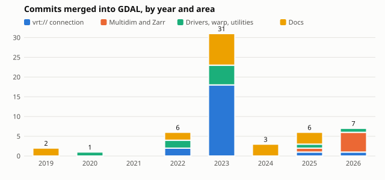

# Contributions merged upstream

Generated from git history by `scripts/sweep.sh` and
`scripts/contributions.py` (last run 2026-10-25). The unit is a commit
authored by me that landed on the upstream default branch. Commits that a
maintainer rewrote under their own name are not counted, so this is a lower
bound.

Summary:

| Project | Commits | Since | Main themes |
|---|---|---|---|
| GDAL | 56 | 2019 | vrt:// connection syntax (22), docs (18), multidim and Zarr (6), drivers and warp (10) |
| PROJ | 1 | 2022 | docs typo ([#3275](https://github.com/OSGeo/PROJ/pull/3275), backported in #3276) |
| GEOS | 2 | 2022 | [#624](https://github.com/libgeos/geos/pull/624) GeosOp explode description, [#961](https://github.com/libgeos/geos/pull/961) home page link |

Highlights, GDAL:

- **vrt:// connection protocol**: most of its options were added by me,
  2022-2026: a_srs, a_ullr, ovr, expand, a_offset/a_scale, ot, gcp, if,
  scale/exponent, outsize, projwin, projwin_srs, oo, tr/r/srcwin/a_gt,
  scale/unscale, a_coord_epoch, nogcp, eco/epo, sd_name/sd, transpose, block.
- **New driver**: NSIDCbin (sea ice concentration binaries), #7263.
- **Options**: netCDF ASSUME_LONGLAT (#6910), CSV pipe separator (#6901),
  MEM SPATIALREFERENCE (#7272), gdal_translate -dmo (#8935), geoloc
  GEOLOC_NORMALIZE_LONGITUDE_MINUS_180_PLUS_180 (#12651).
- **Warp**: overview choice with longitude wrap (#7078, fixes #7019).
- **Multidim**: GDALMDArrayGuessGeoTransform and SWIG binding (#14569),
  MDArray.GetRegularSpacing (#14574), valid axis check in transpose (#12357),
  mdim mosaic unit propagation (#14882).
- **Zarr**: V3 numpy datetime64/timedelta64 extension types (#13913).

Not yet captured: issues I opened upstream (bug reports and feature requests
are a large part of the contribution but are not in git). List them from
https://github.com/OSGeo/gdal/issues?q=author%3Amdsumner and
https://github.com/OSGeo/PROJ/issues?q=author%3Amdsumner .

## GDAL, by area

### vrt:// connection (22)

| Date | PR | Commit | Change |
|---|---|---|---|
| 2026-01-28 | [#13786](https://github.com/OSGeo/gdal/pull/13786) | [6eec9417a](https://github.com/OSGeo/gdal/commit/6eec9417a) | Add `block` option to vrt:// connection protocol (#13786) |
| 2025-05-14 | [#12366](https://github.com/OSGeo/gdal/pull/12366) | [385efff49](https://github.com/OSGeo/gdal/commit/385efff49) | VRT: 'transpose' for vrt:// connection (#12366) |
| 2023-12-06 | [#8906](https://github.com/OSGeo/gdal/pull/8906) | [c3ef81795](https://github.com/OSGeo/gdal/commit/c3ef81795) | VRT: add 'sd_name' and 'sd' options for vrt:// connection (#8906) |
| 2023-09-16 | [#8405](https://github.com/OSGeo/gdal/pull/8405) | [ecfd39c5c](https://github.com/OSGeo/gdal/commit/ecfd39c5c) | clarify syntax of vrt:// 'key=true/false' options |
| 2023-09-16 | [#8405](https://github.com/OSGeo/gdal/pull/8405) | [68bfc3247](https://github.com/OSGeo/gdal/commit/68bfc3247) | VRT 'eco' 'epo' for vrt:// connection |
| 2023-09-15 | [#8397](https://github.com/OSGeo/gdal/pull/8397) | [8c72f3063](https://github.com/OSGeo/gdal/commit/8c72f3063) | VRT 'nogcp' for vrt:// connection |
| 2023-09-13 | [#8375](https://github.com/OSGeo/gdal/pull/8375) | [6fb2f0818](https://github.com/OSGeo/gdal/commit/6fb2f0818) | VRT 'a_coord_epoch' for vrt:// connection (#8375) |
| 2023-09-08 | [#8366](https://github.com/OSGeo/gdal/pull/8366) | [f4fb403f9](https://github.com/OSGeo/gdal/commit/f4fb403f9) | VRT 'scale' 'unscale' for vrt:// connection (#8366) |
| 2023-09-05 | [#8339](https://github.com/OSGeo/gdal/pull/8339) | [f5f00528e](https://github.com/OSGeo/gdal/commit/f5f00528e) | VRT 'oo' for vrt:// connection |
| 2023-09-05 | [#8330](https://github.com/OSGeo/gdal/pull/8330) | [62400aa8e](https://github.com/OSGeo/gdal/commit/62400aa8e) | VRT 'tr', 'r', 'srcwin', 'a_gt' for vrt:// connection (#8330) |
| 2023-09-04 | [#8323](https://github.com/OSGeo/gdal/pull/8323) | [8163f53b5](https://github.com/OSGeo/gdal/commit/8163f53b5) | VRT 'projwin_srs' for vrt:// connection |
| 2023-09-04 | [#8320](https://github.com/OSGeo/gdal/pull/8320) | [aea34c7f9](https://github.com/OSGeo/gdal/commit/aea34c7f9) | VRT 'projwin' for vrt:// connection |
| 2023-04-03 | [#7548](https://github.com/OSGeo/gdal/pull/7548) | [404c8c4d4](https://github.com/OSGeo/gdal/commit/404c8c4d4) | VRT: add 'outsize' option for vrt:// connection (#7548) |
| 2023-03-27 | [#7521](https://github.com/OSGeo/gdal/pull/7521) | [b235e5559](https://github.com/OSGeo/gdal/commit/b235e5559) | VRT 'scale' and 'exponent' option for vrt:// connection |
| 2023-03-15 | [#7333](https://github.com/OSGeo/gdal/pull/7333) | [1faf6d1a0](https://github.com/OSGeo/gdal/commit/1faf6d1a0) | VRT: add 'if' option for vrt:// connection (#7333) |
| 2023-02-27 | [#7316](https://github.com/OSGeo/gdal/pull/7316) | [a33cf6539](https://github.com/OSGeo/gdal/commit/a33cf6539) | VRT: add 'gcp' option for vrt:// connection (#7316) |
| 2023-02-23 | [#7309](https://github.com/OSGeo/gdal/pull/7309) | [efafc1ac9](https://github.com/OSGeo/gdal/commit/efafc1ac9) | VRT 'ot' option for vrt:// connection |
| 2023-02-23 | [#7300](https://github.com/OSGeo/gdal/pull/7300) | [70dd1f6df](https://github.com/OSGeo/gdal/commit/70dd1f6df) | VRT: add 'a_offset' and 'a_scale' options for vrt:// connection (#7300) |
| 2023-02-22 | [#7290](https://github.com/OSGeo/gdal/pull/7290) | [271bc54e6](https://github.com/OSGeo/gdal/commit/271bc54e6) | VRT: add  'expand' option for vrt:// connection (#7290) |
| 2023-02-22 | [#7287](https://github.com/OSGeo/gdal/pull/7287) | [2734dc5fa](https://github.com/OSGeo/gdal/commit/2734dc5fa) | VRT: add "ovr" option for vrt:// connection (#7287) |
| 2022-12-12 | [#6900](https://github.com/OSGeo/gdal/pull/6900) | [9842add45](https://github.com/OSGeo/gdal/commit/9842add45) | VRT: add 'a_ullr' option for vrt:// connection string (#6900) |
| 2022-12-11 | [#6893](https://github.com/OSGeo/gdal/pull/6893) | [ec0311436](https://github.com/OSGeo/gdal/commit/ec0311436) | VRT: add 'a_srs' option for vrt:// connection string (#6893) |

### Multidim and Zarr (6)

| Date | PR | Commit | Change |
|---|---|---|---|
| 2026-07-03 | [#14882](https://github.com/OSGeo/gdal/pull/14882) | [e7fd221c1](https://github.com/OSGeo/gdal/commit/e7fd221c1) | gdal mdim mosaic: propagate Unit for each dimension's indexing variable (#14882) |
| 2026-06-16 | [#14806](https://github.com/OSGeo/gdal/pull/14806) | [c5d07707a](https://github.com/OSGeo/gdal/commit/c5d07707a) | Change 'step' to 'increment' in RegularlySpacedValues example |
| 2026-05-18 | [#14574](https://github.com/OSGeo/gdal/pull/14574) | [3e989f197](https://github.com/OSGeo/gdal/commit/3e989f197) | SWIG: add MDArray.GetRegularSpacing() (#14574) |
| 2026-05-13 | [#14569](https://github.com/OSGeo/gdal/pull/14569) | [7e0e87ad6](https://github.com/OSGeo/gdal/commit/7e0e87ad6) | Add GDALMDArrayGuessGeoTransform() and corresponding SWIG API |
| 2026-02-15 | [#13913](https://github.com/OSGeo/gdal/pull/13913) | [6ec1ab0f1](https://github.com/OSGeo/gdal/commit/6ec1ab0f1) | Zarr: handle numpy.datetime64/timedelta64 extension types in V3 (#13913) |
| 2025-05-13 | [#12357](https://github.com/OSGeo/gdal/pull/12357) | [0c3881b6b](https://github.com/OSGeo/gdal/commit/0c3881b6b) | ensure valid axis values in mdim transpose |

### Drivers, warp, utilities (10)

| Date | PR | Commit | Change |
|---|---|---|---|
| 2026-05-22 | - | [8a9d4a1a4](https://github.com/OSGeo/gdal/commit/8a9d4a1a4) | some tiny fixes |
| 2025-06-28 | [#12651](https://github.com/OSGeo/gdal/pull/12651) | [60f1c445b](https://github.com/OSGeo/gdal/commit/60f1c445b) | Geloc transformer: add a GEOLOC_NORMALIZE_LONGITUDE_MINUS_180_PLUS_180 transformer option to force  apply longitude 180 normalization (#12651) |
| 2023-12-14 | [#8935](https://github.com/OSGeo/gdal/pull/8935) | [633c79f54](https://github.com/OSGeo/gdal/commit/633c79f54) | gdal_translate: add -dmo option, for domain-metadata items (#8935) |
| 2023-08-02 | [#8168](https://github.com/OSGeo/gdal/pull/8168) | [2db55cc37](https://github.com/OSGeo/gdal/commit/2db55cc37) | apply vsis3 protocol to STACIT s3:// items |
| 2023-02-20 | [#7272](https://github.com/OSGeo/gdal/pull/7272) | [43740ec79](https://github.com/OSGeo/gdal/commit/43740ec79) | MEM: Adds 'SPATIALREFERENCE' element to the DSN format.  (#7272) |
| 2023-02-17 | [#7263](https://github.com/OSGeo/gdal/pull/7263) | [72e80fdda](https://github.com/OSGeo/gdal/commit/72e80fdda) | NSIDCbin: Sea Ice Concentrations new raster driver  (#7263) |
| 2023-01-17 | [#7078](https://github.com/OSGeo/gdal/pull/7078) | [c815cf02e](https://github.com/OSGeo/gdal/commit/c815cf02e) | gdalwarp: overview choice, fix longitude wrap problem (#7078) (fixes #7019) |
| 2022-12-15 | [#6910](https://github.com/OSGeo/gdal/pull/6910) | [a733bf0a0](https://github.com/OSGeo/gdal/commit/a733bf0a0) | netCDF: add a ASSUME_LONGLAT open option (#6910) (fixes #6195) |
| 2022-12-12 | [#6901](https://github.com/OSGeo/gdal/pull/6901) | [e8b253032](https://github.com/OSGeo/gdal/commit/e8b253032) | CSV: recognize pipe separator and .psv extension for read (#6901) (fixes #6811) |
| 2020-10-02 | [#2997](https://github.com/OSGeo/gdal/pull/2997) | [d13960456](https://github.com/OSGeo/gdal/commit/d13960456) | shp/ subdir for poly.zip (#2997) |

### Docs (18)

| Date | PR | Commit | Change |
|---|---|---|---|
| 2025-05-09 | [#12319](https://github.com/OSGeo/gdal/pull/12319) | [63b2ce5a6](https://github.com/OSGeo/gdal/commit/63b2ce5a6) | gdal_raster_tile.rst: tiny fix max zoom |
| 2025-01-16 | [#11668](https://github.com/OSGeo/gdal/pull/11668) | [52bfd1122](https://github.com/OSGeo/gdal/commit/52bfd1122) | DOC: software using, remove defunct product |
| 2025-01-14 | [#11647](https://github.com/OSGeo/gdal/pull/11647) | [ff557b8d3](https://github.com/OSGeo/gdal/commit/ff557b8d3) | DOC: configoptions fix ignore-env-var directive |
| 2024-11-01 | [#11184](https://github.com/OSGeo/gdal/pull/11184) | [f21634b46](https://github.com/OSGeo/gdal/commit/f21634b46) | Update gti.rst |
| 2024-09-08 | [#10748](https://github.com/OSGeo/gdal/pull/10748) | [048be3837](https://github.com/OSGeo/gdal/commit/048be3837) | doc: various typos in comments and doc from spelling list |
| 2024-07-09 | [#10388](https://github.com/OSGeo/gdal/pull/10388) | [b9b1ffb14](https://github.com/OSGeo/gdal/commit/b9b1ffb14) | gdaldem.rst - mention alpha column, not used without -alpha |
| 2023-12-06 | [#8919](https://github.com/OSGeo/gdal/pull/8919) | [5a4d0ed83](https://github.com/OSGeo/gdal/commit/5a4d0ed83) | configoptions.rst: a few typos |
| 2023-11-18 | [#8744](https://github.com/OSGeo/gdal/pull/8744) | [3efeae262](https://github.com/OSGeo/gdal/commit/3efeae262) | Update configoptions.rst - remove stray quote |
| 2023-08-29 | [#8284](https://github.com/OSGeo/gdal/pull/8284) | [7a5551865](https://github.com/OSGeo/gdal/commit/7a5551865) | dev_environment.rst: fix docker  label |
| 2023-05-26 | [#7838](https://github.com/OSGeo/gdal/pull/7838) | [9e11c56e0](https://github.com/OSGeo/gdal/commit/9e11c56e0) | gpkg.rst stray backticks |
| 2023-05-26 | [#7837](https://github.com/OSGeo/gdal/pull/7837) | [632a085d4](https://github.com/OSGeo/gdal/commit/632a085d4) | Update vrt.rst - fix tiny typo |
| 2023-05-09 | [#7718](https://github.com/OSGeo/gdal/pull/7718) | [b9926c4be](https://github.com/OSGeo/gdal/commit/b9926c4be) | warp_tut.rst: small fixes |
| 2023-05-01 | [#7665](https://github.com/OSGeo/gdal/pull/7665) | [889ded7f9](https://github.com/OSGeo/gdal/commit/889ded7f9) | Update raster_data_model.rst |
| 2023-02-08 | [#7201](https://github.com/OSGeo/gdal/pull/7201) | [850e886ac](https://github.com/OSGeo/gdal/commit/850e886ac) | padfExtent/s consistency, and small doc fixes |
| 2022-04-01 | [#5556](https://github.com/OSGeo/gdal/pull/5556) | [63e86cdd2](https://github.com/OSGeo/gdal/commit/63e86cdd2) | tiny update osr_api_tut.rst |
| 2022-03-08 | [#5412](https://github.com/OSGeo/gdal/pull/5412) | [7f0e047a8](https://github.com/OSGeo/gdal/commit/7f0e047a8) | vrt.rst:  example code, xml domain for VRT content (#5412) |
| 2019-09-20 | [#1869](https://github.com/OSGeo/gdal/pull/1869) | [768a63b8b](https://github.com/OSGeo/gdal/commit/768a63b8b) | fix tiny typo |
| 2019-05-23 | [#1565](https://github.com/OSGeo/gdal/pull/1565) | [31f7f7c39](https://github.com/OSGeo/gdal/commit/31f7f7c39) | Fix typo in name of libkea (#1565) |
