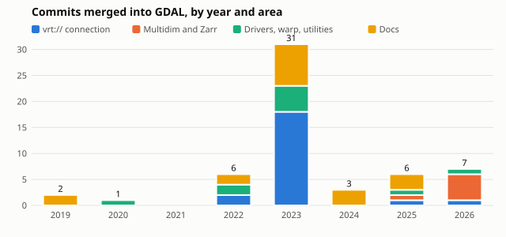

# osgeo-upstream

Personal notes and tracking for my contributions to GDAL, PROJ and GEOS.
Not an OSGeo project.

- Code lives in fork branches: mdsumner/gdal, mdsumner/PROJ, mdsumner/geos.
- Issues here are ideas, bugs and follow-ups, labelled by project and area.
- notes/ holds longer write-ups and repro scripts; LEDGER.md records each
  learnt fact with the check that guards it.

## Where things are

| File | What it holds |
|---|---|
| [CONTRIBUTIONS.md](CONTRIBUTIONS.md) | Work already merged upstream |
| [PLANS.md](PLANS.md) | Everything in flight or proposed, with status |
| [RUNDOWN.md](RUNDOWN.md) | Ranked open issues, generated from labels; start here |
| [PRIORITIES.md](PRIORITIES.md) | What to work on next, in order, and why |
| [STRATEGY.md](STRATEGY.md) | Direction, themes and how contributions are made |
| [LEDGER.md](LEDGER.md) | Learnt facts and the check behind each |
| [notes/](notes/) | Sweeps, triage notes, repros |
| [scripts/sweep.sh](scripts/sweep.sh) | Re-runs the status sweep (read-only git) |
| [scripts/rundown.py](scripts/rundown.py) | Renders RUNDOWN.md (also run by an Action on every issue change) |

## Intake

Found a bug, limitation or need in GDAL, PROJ or GEOS while working on
something downstream? Open an issue with the
[upstream gap form](../../issues/new?template=upstream-gap.yml). It lands in
the RUNDOWN.md Inbox with a suggested priority; add a `P` label and an area
label to rank it.

## Labels

Project and area: `gdal:vrt`, `gdal:mdim`, `gdal:zarr`, `gdal:netcdf`,
`gdal:warp`, `gdal:drivers`, `gdal:python`, `gdal:docs`, `proj`, `geos`.

Status: `status:idea`, `status:investigating`, `status:ready` (repro and fix
description written, waiting for me to write code), `status:upstream`
(upstream issue or PR open), `status:done`, `status:parked`.

Priority: `P1`, `P2`, `P3`.

## How contributions are made

GDAL and PROJ have LLM tool policies (GDAL RFC 111, PROJ ai_tool_policy).
Code, tests, commit messages and upstream issue or PR text are written by me.
Tooling is used here, in this tracker, for triage, reading upstream code and
history, and writing repros and notes. Any tool use is declared upstream in
the PR template.
